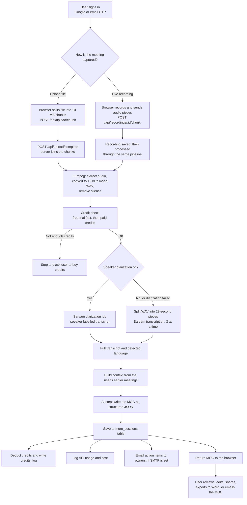
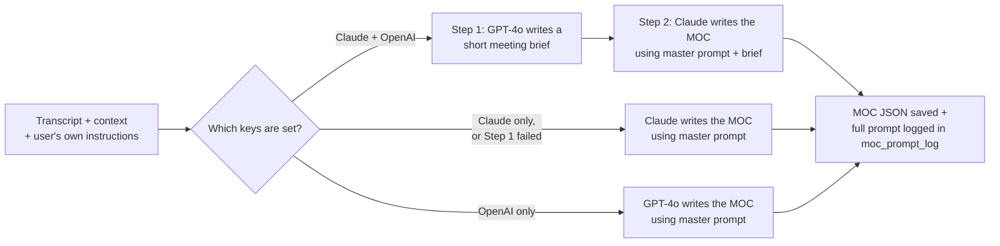
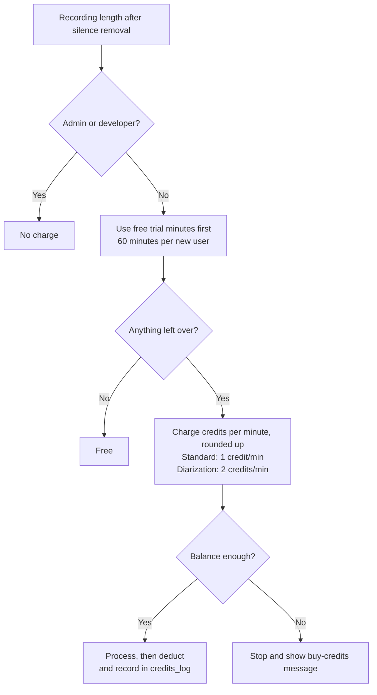

# AiX Track — MOC Generator

AiX Track turns a meeting recording into structured **Minutes of Conversation (MOC)**. The MOC includes the summary, discussion points, decisions, action items with owners and due dates, and the next meeting. Users can upload an audio or video file, or record the meeting live in the browser.

This document explains how the application works, step by step, for anyone reviewing or maintaining the code.

---

## 1. At a glance

| Item | Detail |
|---|---|
| Type | Web application (Node.js server and plain HTML/JS pages) |
| Server | Node.js with Express 5, one main file: `server.js` |
| Database | PostgreSQL (hosted on Neon in production) |
| Speech-to-text | Sarvam AI (standard transcription and speaker diarization) |
| MOC writing | Primary AI: Anthropic Claude. Secondary AI: OpenAI GPT-4o, used to prepare a meeting brief, or as the only engine when no Claude key is set |
| Audio processing | FFmpeg (bundled through npm, so no separate install is needed) |
| Login | Google sign-in, or a one-time code (OTP) sent by email |
| Payments | Razorpay (credit packs) |
| Email | SMTP through Nodemailer (OTP codes, action items, MOC sharing, alerts) |
| Hosting | Linux VPS with pm2 and Nginx (see `ops/README.md`) |

> End users never see AI vendor names in the app. The screens say "Primary AI", "Secondary AI" or "AI engine". Provider names appear only on admin pages and in this technical document.

---

## 2. End-to-end flow



### Step by step

1. **Sign in.** The user signs in with Google (`/auth/google`) or requests a 6-digit code by email (`/auth/otp/request`, then `/auth/otp/verify`). The session is stored in PostgreSQL and lasts 30 days.
2. **Upload or record.**
   - **Upload:** the browser cuts the file into chunks of up to 10 MB and sends them one by one. Each upload is tied to the logged-in user, so nobody else can complete it. `/api/upload/complete` then joins the chunks into one file.
   - **Live recording:** `/api/recordings/start` opens a recording, pieces arrive in order through `/api/recordings/:id/chunk`, and `/api/recordings/:id/status` tracks its state.
3. **Prepare the audio.** FFmpeg extracts the audio track from video, converts it to 16 kHz mono WAV and removes long silences. This makes the recording shorter, which lowers cost. Recordings longer than `MAX_AUDIO_HOURS` (10 hours by default) are refused.
4. **Check credits.** See [section 4](#4-credits-and-billing). If the user can't pay for the recording, processing stops before any paid API is called.
5. **Transcribe.**
   - **With diarization:** the whole file goes to Sarvam's diarization service, which labels who said what. If that fails, the app falls back to standard transcription and charges the standard rate.
   - **Standard:** the WAV is split into 29-second pieces and sent to Sarvam, 3 pieces at a time. The text is then joined in order, and the language is detected for each piece.
6. **Add context.** The server collects a short summary of the user's recent meetings and open action items, so the AI can link the new MOC to earlier ones.
7. **Write the MOC.** See [section 3](#3-ai-flow-how-the-moc-is-written).
8. **Save and charge.** The MOC is saved in `mom_sessions`, credits are deducted, and every paid API call is written to `api_usage_log` with its cost in USD.
9. **Follow-up.** If email is configured, action-item owners can be emailed their tasks. The user can edit the MOC, tag it, mark action items done, regenerate it, share a read-only link, draft an email, or export a `.docx` file.

---

## 3. AI flow: how the MOC is written



- **Master prompt:** the main instructions for writing a MOC. The default text is in `prompts/master-moc-prompt.md`. Admins can save new versions and choose which one is active from the Prompts page (`/api/admin/master-prompt`), and every version is kept in the `master_prompts` table.
- **User instructions:** a user can add their own instructions in settings, or for a single session. These are added to the master prompt; they don't replace it.
- **Models:** the Claude model is set in `MOC_MODEL` and the brief-writer model in `COMPOSER_MODEL`, both near line 1460 of `server.js`.
- **Audit trail:** for every MOC, the exact prompt, the brief, the models used and any errors are saved in `moc_prompt_log`. This lets an admin see why a MOC came out the way it did.
- **Safety:** the master prompt tells the AI to treat meeting content as data, not instructions. It also tells the AI not to invent owners, dates or decisions, and to hide passwords and other secrets that appear in the transcript.
- **Human review:** every MOC is saved as a draft. Users should check it before sharing.

---

## 4. Credits and billing



- The rates come from `CREDITS_PER_MIN_STANDARD` and `CREDITS_PER_MIN_DIARIZATION` in `.env`, so prices can change without code changes. The UI reads them from `/api/config/rates`.
- Diarization uses up the free trial twice as fast, the same as paid credits.
- **Buying credits:** `/api/credits/create-order` creates a Razorpay order. Credits are added after the payment is verified, either by `/api/credits/verify-payment` or by the Razorpay webhook (`/api/razorpay/webhook`). Each webhook event is stored once, so a payment can't be credited twice.
- **Referrals:** a link like `/r/<code>` records who referred a new user, and a reward is applied once the conditions in the code are met.

---

## 5. Project structure

```
mom-tool/
├── server.js                 Main application: routes, audio pipeline, AI, credits, admin, email
├── prompts/
│   └── master-moc-prompt.md  Default master prompt for writing a MOC
├── public/                   Web pages (plain HTML, CSS and JS, served directly)
│   ├── index.html            Main screen: upload or record, then view the MOC
│   ├── history.html          Past MOCs: search, edit, share, export
│   ├── actions.html          Action items across all meetings
│   ├── login.html            Sign in (Google or email code)
│   ├── profile.html          User profile and settings
│   ├── credits.html          Credit balance and purchase history
│   ├── pricing.html          Credit packs
│   ├── share.html            Read-only shared MOC (/s/<token>)
│   ├── admin.html            Admin: users, roles, credits
│   ├── usage.html            Admin: API usage per user and session
│   ├── cost.html             Admin: cost and provider balances
│   ├── prompts.html          Admin: master prompt versions and prompt log
│   ├── activity.html         Admin: activity view
│   ├── logging.html          Admin: logging view
│   ├── terms.html, privacy.html, refund.html   Legal pages
│   ├── css/                  Shared styles and dark theme
│   └── js/                   rates.js (credit rates), referral.js, theme.js
├── ops/                      Server operations: backups, restore test, health check, Nginx
│   └── README.md             How to set these up on the server
├── auth.js, db.js, storage.js   Older helper files. server.js does not use them.
├── .env.example              List of settings to fill in (copy to .env)
└── package.json              Dependencies and the start command
```

---

## 6. Database tables

`server.js` creates these tables automatically on start (`initDB()`), so you don't need to set them up by hand.

| Table | Holds |
|---|---|
| `users` | Accounts, role (user / admin / developer), credits, free minutes used, personal settings |
| `mom_sessions` | Each MOC: transcript, summary, decisions, action items, language, tags, share token, credits charged |
| `recording_uploads` | Live recordings and their status |
| `credits_log` | Every credit added or deducted, with the balance after |
| `credit_orders` | Razorpay orders and payment status |
| `razorpay_webhook_events` | Webhook events already processed (prevents double credit) |
| `api_usage_log` | Each paid API call: service, units, cost in USD |
| `provider_balances` | Balance and top-ups for each AI provider, in USD or ₹, plus the latest real spend read from the provider (for low-balance alerts) |
| `master_prompts` | Master prompt versions and which one is active |
| `moc_prompt_log` | The exact prompt and models used for each MOC |
| `app_settings` | App-wide settings (for example hosting cost) |
| `auth_otps` | Email login codes (short-lived) |
| `consent_log` | Records of user consent before an upload is processed or a recording starts |
| `user_sessions` | Login sessions (created by `connect-pg-simple`) |

---

## 7. Main API routes

All `/api/*` routes need a logged-in user unless noted. Admin routes also need an admin role.

| Area | Routes |
|---|---|
| Login | `GET /auth/google`, `POST /auth/otp/request`, `POST /auth/otp/verify`, `POST /auth/logout`, `GET /api/me` |
| Upload | `POST /api/upload/chunk`, `POST /api/upload/complete`, `POST /api/transcribe` (single-file upload) |
| Live recording | `POST /api/recordings/start`, `POST /api/recordings/:id/chunk`, `POST /api/recordings/:id/status`, `GET /api/recordings/:id/file`, `POST /api/draft-recording` |
| MOC history | `GET /api/history`, `GET/PATCH/DELETE /api/history/:id`, `POST /api/history/:id/regenerate`, `PATCH /api/history/:id/tags` |
| Action items | `PATCH /api/history/:id/action/:idx`, `PATCH /api/history/:id/action/:idx/email`, `POST /api/history/:id/action/:idx/send` |
| Sharing and export | `POST/DELETE /api/history/:id/share`, `GET /api/share/:token` (no login), `POST /api/history/:id/send-email`, `POST /api/history/:id/draft-email`, `GET /api/history/:id/export/docx` |
| Credits | `GET /api/credits/balance`, `GET /api/credits/preflight`, `POST /api/credits/create-order`, `POST /api/credits/verify-payment`, `POST /api/razorpay/webhook` (called by Razorpay, no login), `GET /api/credits/my-orders` |
| User | `GET/POST /api/user/settings`, `GET /api/user/me`, `PATCH /api/user/profile`, `DELETE /api/user/account` |
| Admin | `/api/admin/users`, `/api/admin/usage`, `/api/admin/cost-intelligence`, `/api/admin/master-prompt`, `/api/admin/prompt-log`, `/api/admin/orders`, `/api/admin/storage`, `/api/admin/provider-balances` |
| Health | `GET /health` (no login; used by the health check and uptime monitors) |

---

## 8. Security and controls built in

| Control | How it works |
|---|---|
| Secrets kept out of code | All keys are read from `.env`, and `.gitignore` stops `.env` from being committed |
| Rate limits | Limits on login codes (5 per 15 min), uploads, transcription and the API in general |
| Upload ownership | Each chunked upload and recording is tied to the user who started it |
| Credit check before cost | Paid APIs are only called after the credit check passes |
| No double payment credit | Razorpay webhook events are stored and processed once |
| Roles | Admin pages and routes check the user's role on the server, not only in the browser |
| Audit trail | `credits_log`, `api_usage_log` and `moc_prompt_log` record who used what, the cost and the prompt |
| Alerts | Emails for server crashes, error spikes, low provider balances, failed backups and app downtime (see `ops/README.md`) |
| Backups | Daily database backup with a 14-day retention and a monthly restore test (see `ops/README.md`) |

---

## 9. Run it locally

**You need:** Node.js 18 or newer and a PostgreSQL database (local, or a free Neon database).

```bash
# 1. Install dependencies
npm install

# 2. Create your settings file
cp .env.example .env
#    then open .env and fill in the values (see the table below)

# 3. Start the app
npm start
```

Open **http://localhost:3000** (or the `PORT` you set).

### Minimum settings in `.env`

| Setting | Needed for |
|---|---|
| `DATABASE_URL` | PostgreSQL connection string. **Required** |
| `SESSION_SECRET` | Signs login sessions. **Required**: any long random string |
| `SARVAM_API_KEY` | Transcription. **Required** |
| `ANTHROPIC_API_KEY` | Primary AI for writing the MOC. Need this or `OPENAI_API_KEY` |
| `OPENAI_API_KEY` | Secondary AI (meeting brief, or the only engine if no Claude key) |
| `SARVAM_DIARIZATION_KEY` | Optional separate key for speaker diarization |
| `GOOGLE_CLIENT_ID`, `GOOGLE_CLIENT_SECRET`, `GOOGLE_CALLBACK_URL` | Google sign-in |
| `SMTP_HOST`, `SMTP_PORT`, `SMTP_USER`, `SMTP_PASS`, `SMTP_FROM` | Email. **If `SMTP_HOST` is empty, the app runs in dev mode and does not send emails** |
| `RAZORPAY_KEY_ID`, `RAZORPAY_KEY_SECRET` | Credit purchases |
| `ADMIN_SECRET` | Secret key that also opens admin routes (in addition to the admin role) |
| `APP_URL` | Public address, used in emails and share links |
| `CREDITS_PER_MIN_STANDARD`, `CREDITS_PER_MIN_DIARIZATION`, `MAX_AUDIO_HOURS` | Optional pricing and limits (defaults: 1, 2, 10) |
| `ANTHROPIC_ADMIN_KEY`, `OPENAI_ADMIN_KEY` | Optional. Let the app read real spend from Claude and ChatGPT billing for the balance tracker. Without them, spend is estimated from the app's own usage log |
| `BALANCE_ALERT_EMAILS`, `PROVIDER_BALANCE_THRESHOLD_USD`, `PROVIDER_BALANCE_THRESHOLD_INR`, `USD_INR` | Who gets provider balance emails, default alert levels ($2, ₹1,000) and the ₹ per $ rate (84) |

> Never commit `.env` or share it by email or chat. If a key is ever exposed, revoke it at the provider and create a new one.

---

## 10. Deployment

Production runs on a Linux VPS:

- **pm2** keeps the Node app running and restarts it if it crashes.
- **Nginx** sits in front of the app with HTTPS. Its timeouts and upload size are raised for long recordings (up to 2 GB and 4 hours).
- **Cron jobs** run the daily database backup and a health check every 5 minutes.

The full server setup is in [`ops/README.md`](ops/README.md).

---

## 11. Known limitations

- Most of the server logic is in one large file (`server.js`, about 6,000 lines). Splitting it into modules for routes, audio, AI and billing would make maintenance easier.
- There are no automated tests yet (`npm test` is a placeholder).
- Uploaded audio is stored on the server's local disk (`uploads/`), so disk space needs monitoring. The health check alerts at 85% full.
- AI-generated MOCs can contain mistakes. They are saved as drafts and need human review before they're shared.
